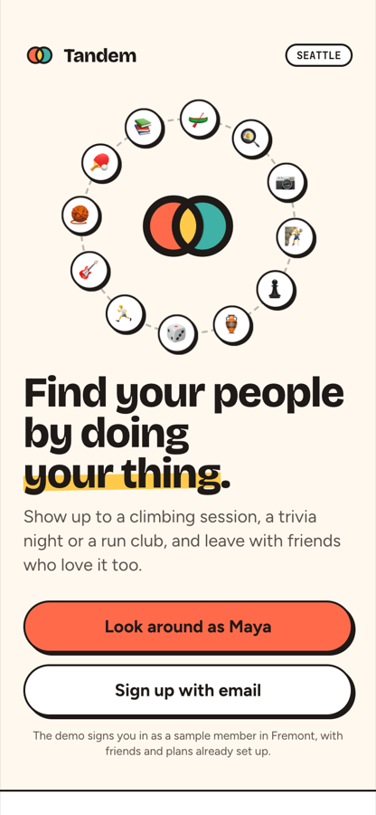
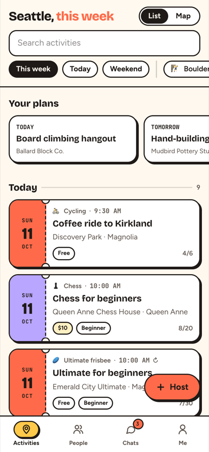
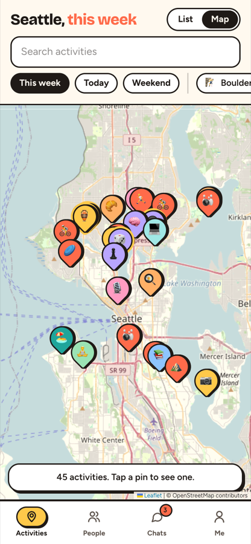
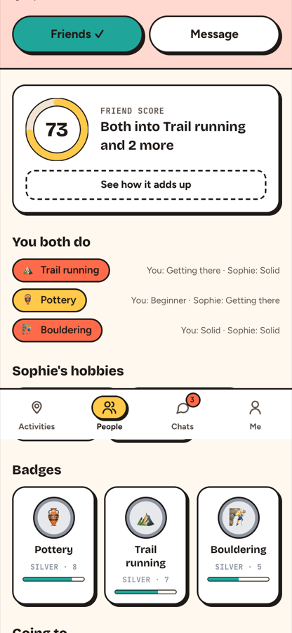

# Tandem

**Find your people by doing your thing.** Tandem is a Seattle-first app for making friends through
hobbies: real activities on a map (hosted by people and local spots), people ranked by an
explainable **Friend Score**, real-time group chats, badges, a Vibe Check quiz, and automatic
small-group suggestions built from overlapping free time.

**Live demo:** https://tandem-779591146096.us-central1.run.app — tap **"Look around as Maya"** to explore a seeded account.

<p>
  
  
  
  
</p>

## Highlights

- **Explainable Friend Score (0–100)** — `api/app/scoring.py`. Pure, unit-tested functions:
  | component | max | how |
  |---|---|---|
  | Shared hobbies | 55 | Σ IDF(hobby) × level-closeness, saturated with `1 − e^(−x/k)` — sharing a *rare* hobby (Go) counts far more than a common one (hiking) |
  | Free time | 15 | Jaccard overlap of weekly (weekday, slot) availability |
  | Proximity | 15 | `15·e^(−km/6)` haversine distance between neighborhood centroids |
  | Vibe | 10 | cosine similarity of Vibe Check trait vectors |
  | Age | 5 | `5·e^(−Δage/8)` |

  Every score ships with a breakdown the UI renders as "See how it adds up".
- **Small-group matching** — `api/app/grouping.py`. For each hobby a user is open to and each slot
  they're free, gather nearby open-to-plans people free then, and greedily grow a 3–5 person group
  maximizing average *pairwise* Friend Score (memoized pair scorer, de-duplicated groups). Accepting
  a suggestion spins up a group chat with an opening message and suggested date.
- **Real-time chat** over WebSockets (per-user connection fan-out, typing indicators, unread counts,
  keep-alive pings, auto-reconnect on the client) with a server-side language filter.
- **Activities with privacy**: "general area" activities show a jittered ~400 m circle and hidden
  venue until the host approves you; capacity + waitlist with auto-promotion; check-in window;
  post-activity ratings; recurring weekly events; Google Calendar export.
- **Badges** Bronze → Legendary per hobby, derived from check-ins (never stored, always consistent).
- **"Describe your hobbies"** — free text → hobby chips via Gemini when `GEMINI_API_KEY` is set,
  with a deterministic keyword/fuzzy fallback.
- **Privacy by design**: first name + last initial only, age (never birth date), neighborhood
  centroid (never exact location), Instagram only for friends.

## Stack

| | |
|---|---|
| Frontend | React 19, TypeScript, Vite, Tailwind CSS v4, React Router, Leaflet / OpenStreetMap |
| Backend | FastAPI, SQLModel (SQLite, Postgres-ready via `DATABASE_URL`), JWT auth, WebSockets |
| Quality | pytest (scoring properties, grouping constraints, end-to-end API + WebSocket flows), GitHub Actions CI |
| Deploy | Multi-stage Docker image (Node build → Python runtime serving API + SPA) on Google Cloud Run |

```
web/ (React SPA) ──/api, /ws──▶ api/ FastAPI ──▶ SQLModel ──▶ SQLite / Postgres
                                  ├─ scoring.py   Friend Score
                                  ├─ grouping.py  group suggestions
                                  ├─ ws.py        chat fan-out
                                  └─ seed.py      deterministic Seattle demo world
```

## Run locally

```bash
# API (seeds a demo world on first start)
cd api && uv run uvicorn app.main:app --reload --port 8001
# Web
cd web && npm install && npm run dev        # http://localhost:5173
# Tests
cd api && uv run pytest
```

Sign-in is passwordless by email code; in dev the code is returned in the response so no email
provider is needed. The demo deployment reseeds itself, so data you create there is temporary.

See [`SPEC.md`](SPEC.md) for the full domain model and API contract.

---
Inspired by [hobbyful.app](https://hobbyful.app); Tandem is an independent project with its own
design and code.
